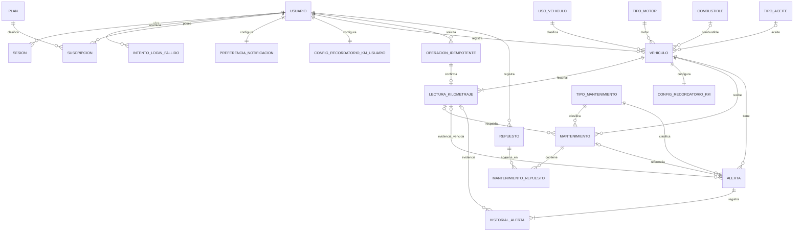

# MyCar — Modelo lógico relacional del MVP (11 RF)

**Origen:** diccionario `MyCar_Diccionario_MVP_Cuatro_Ajustes_Documentales_APLICADOS_20261026(1).xlsx`, última versión aprobada. **Destino:** PostgreSQL, base nueva `mycar_mvp`, esquema `mycar`. **Alcance:** 21 tablas (20 de negocio/soporte existentes en el diccionario más `intento_login_fallido`). No incluye módulos TIVE, pagos, SOAT, administración, talleres, fotos personalizadas ni premium operativo.

## Inventario de relaciones (PK y FK)

| Tabla | Clave primaria | FKs principales y cardinalidad |
|---|---|---|
| `usuario` | `id_usuario` | Raíz de propietario/identidad |
| `plan` | `id_plan` | Catálogo para suscripción |
| `suscripcion` | `id_suscripcion` | `id_usuario` → usuario (1:N histórica), `id_plan` → plan (N:1) |
| `preferencia_notificacion` | `id_usuario` | `id_usuario` → usuario (1:1) |
| `config_recordatorio_km_usuario` | `id_usuario` | `id_usuario` → usuario (1:1) |
| `sesion` | `id_sesion` | `id_usuario` → usuario (1:N) |
| `intento_login_fallido` | `id_intento` | `id_usuario` → usuario (1:N) |
| `uso_vehiculo` | `codigo` | Catálogo de uso; FK desde vehículo |
| `tipo_motor` | `id_tipo_motor` | FK desde vehículo |
| `combustible` | `id_combustible` | FK opcional desde vehículo |
| `tipo_aceite` | `id_tipo_aceite` | FK opcional desde vehículo |
| `tipo_mantenimiento` | `id_tipo_mantenimiento` | FK desde mantenimiento y alerta |
| `vehiculo` | `id_vehiculo` | `id_usuario` → usuario; `uso_vehiculo_codigo` → uso; motor, combustible y aceite → catálogos |
| `operacion_idempotente` | `id_operacion` (UUID) | `id_usuario` → usuario; resultado confirmado recuperable |
| `lectura_kilometraje` | `id_lectura_km` | `id_vehiculo` → vehículo, `id_operacion` → operación |
| `config_recordatorio_km` | `id_vehiculo` | `id_vehiculo` → vehículo (1:1) |
| `mantenimiento` | `id_mantenimiento` | `id_vehiculo` → vehículo; `id_tipo_mantenimiento` → catálogo; (`id_lectura_km_referencia`,`id_vehiculo`) → lectura (condicional) |
| `repuesto` | `id_repuesto` | `id_usuario` → usuario |
| `mantenimiento_repuesto` | (`id_mantenimiento`,`id_repuesto`) | FKs a mantenimiento y repuesto; nombre_snapshot obligatorio |
| `alerta` | `id_alerta` | `id_vehiculo` → vehículo; `id_tipo_mantenimiento` → catálogo; FK compuesta hacia mantenimiento de referencia y lectura de evidencia |
| `historial_alerta` | `id_historial_alerta` | `id_alerta` → alerta (1:N), `id_lectura_evidencia` → lectura (opcional) |

## Diagrama lógico resumido (Mermaid)

> El diagrama expresa cardinalidades lógicas de flujo *confirmado*. En PostgreSQL una FK 1:1 no obliga por sí sola a que nazca la fila secundaria: RF01 y RF08 deben crear todas las entidades del conjunto en la misma transacción de Spring Boot.

## Reglas de integridad clave

**RF01/RF02/RF06:** alta atómica usuario + suscripción FREE activa + preferencias + configuración global PAUSADO (sin trigger de alta). Correo único normalizado, edad 18–85, consentimiento fecha/versión. Solo cuenta ACTIVA puede iniciar sesión. Bloqueo temporal 3 fallos móviles/10 min independiente de estado_cuenta. Sesión vigente única por usuario + instalación; tokens siempre hasheados en DB.

**RF08/RF09/RF10/RF14:** placa regex `^[A-Z][0-9][A-Z][0-9]{3}$` y UNIQUE global; VIN opcional UNIQUE. `id_vehiculo` PK estable. Free permite **un vehículo registrado TOTAL**, activo o inactivo: la comprobación requiere una transacción que bloquee usuario, NO un CHECK sobre una tabla. El odómetro se deriva de la última lectura, sin duplicar caché. La lectura INICIAL única se crea en RF08 junto a recordatorio INTERDIARIO/PAUSADO. Actualizaciones RF14 deben superar estrictamente la lectura vigente y ser idempotentes.

**RF17/RF18:** registro REALIZADO, historial de servicio inmutable respecto a RF14, tipo OTRO con detalle; origen LECTURA obliga a referenciar una lectura del MISMO vehículo con el MISMO valor; recomendaciones comparadas con kilometraje/fecha del servicio, no con RF14. Repuestos manuales 0..N, nombre repetible y snapshot obligatorio, marca opcional; el propietario del repuesto debe coincidir con el del vehículo.

**RF22/RF23:** criterio POR_TIEMPO / POR_KILOMETRAJE / AMBOS. Unidades SEMANAS/MESES; fecha mensual según `LocalDate.plusMonths` desde base original. La referencia histórica seleccionada, si existe, es el último servicio REALIZADO válido de ese vehículo y tipo, también servicio OTRO. La `firma_equivalencia` es SHA-256 de serialización canónica estable calculada en backend, con índice parcial para estados activos. RF23 calcula estado por umbrales (tiempo y KM exacto 10%), evidencia verificable de la PRIMERA VENCIDA y ANULADA después de 30 días locales America/Lima. Guardar estado e historial solo cuando hay un cambio real, mismo COMMIT.

## Limitaciones y decisiones de implementación explícitas

- Los valores del catálogo automotriz adicionales a OTRO/eléctrico y el etiquetado de algunas opciones son **semillas propuestas**, no nuevos acuerdos funcionales.
- Este modelo incluye restricciones y triggers defensivos que operan en PostgreSQL; **la autorización HTTP, las sesiones, el flujo de reintentos y la política de Free siguen requiriendo Spring Boot**.
- El hashing SHA-256 canónico de `firma_equivalencia` debe usar la misma normalización NFKC/casefold/espacios y serialización inequívoca en todas las altas. La BD valida longitud y no duplicación del hash, pero no puede deducir el texto canónico si el backend manda uno incorrecto.
- El listado de estados y razones `REALIZADA`/`ANULADA` incluye estados de compatibilidad futura; RF17 no convierte alertas en REALIZADA durante este MVP.
- Ninguna prueba ha sido ejecutada contra una instancia PostgreSQL en este entorno; los scripts de prueba son para ejecutar después de crear las tablas.
