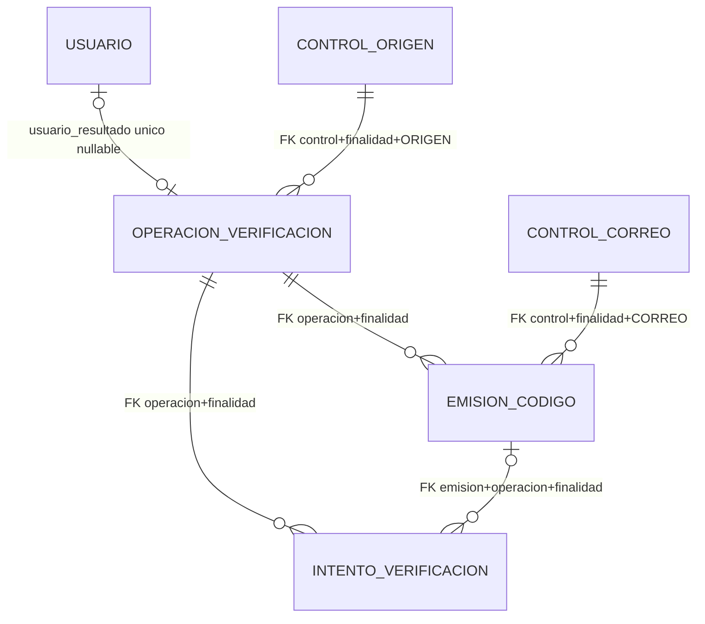

# Relaciones y reglas: implementación exacta, no propuesta nueva

## Cardinalidades y FK reales

Todas las FK siguientes son `ON DELETE RESTRICT`. No hay CASCADE, SET NULL ni cláusula ON UPDATE
personalizada (rige NO ACTION). Las FK no se declaran diferibles; si no se cambia el DDL son inmediatas.

| Padre | Hijo / FK | Cardinalidad y observación |
|---|---|---|
| control_verificacion ORIGEN | operacion_verificacion `(id_control_origen,finalidad,tipo_origen)` → `(id_control,finalidad,tipo)` | Origen 0..N operaciones; cada operación exactamente un origen. `tipo_origen='ORIGEN'`. |
| control_verificacion CORREO | emision_codigo `(id_control_correo,finalidad,tipo_correo)` → `(id_control,finalidad,tipo)` | Correo 0..N emisiones; cada emisión exactamente un correo. `tipo_correo='CORREO'`. Destinatario no se duplica en emisión. |
| operacion_verificacion | emision_codigo `(id_operacion,finalidad)` | Operación 0..N emisiones; cada emisión una operación. Índice parcial: máximo una RESERVADO/ACTIVO, no necesariamente una. |
| operacion_verificacion | intento_verificacion `(id_operacion,finalidad)` | Operación 0..N recibos; cada recibo una operación. |
| emision_codigo | intento_verificacion `(id_emision,id_operacion,finalidad)` | Emisión 0..N recibos. Recibo 0..1 emisión; EMITIR y COMPLETAR exigen emisión, CANCELAR/ABANDONAR pueden ser NULL. Con MATCH SIMPLE implícito el NULL omite esta FK, pero sigue vigente la FK a operación. |
| usuario | operacion_verificacion `usuario_contexto` → `id_usuario` | Columna con FK nullable, pero CHECK obliga NULL: en RF01 la relación de contexto tiene cardinalidad efectiva cero. No está habilitada para RF futuros. |
| usuario | operacion_verificacion `usuario_resultado` → `id_usuario` | Antes de completar NULL; COMPLETADA exige usuario y fecha. Cada operación tiene 0..1 usuario resultado y cada usuario 0..1 operación resultado por índice único parcial. SQL no demuestra que sea usuario recién creado ni que coincida su correo. |

FK compuestas impiden mezclar finalidad, operación, emisión y tipo de control referenciado. No sustituyen
la autorización mediante secreto, que comprueba el backend. La relación de usuario no existe durante la
verificación previa al registro. No se usa la sesión de usuario para autorizar este proceso anónimo.

`usuario.correo_verificado_utc TIMESTAMPTZ` es nullable, sin DEFAULT, backfill ni CHECK adicional.
ALTER TABLE deja NULL en todas las cuentas anteriores. El nuevo caso interno actualiza la cuenta nueva
al comparar satisfactoriamente el OTP, en la misma transacción final. El registro antiguo conserva NULL.
No se añade un requisito nuevo al login ni se cambia el estado de cuentas anteriores. SQL no obliga por
sí solo que una cuenta nueva tenga esa fecha ni que corresponda a una verificación real.

## Reglas implementadas en backend, además del DDL

1. **Formulario:** validadores/privacidad existentes antes de emitir y al completar. Sin persistir formulario
   o contraseña provisional. HMAC de solicitud canónica sí depende de los campos recibidos (incluidos
   contraseña/confirmación y OTP cuando corresponden); no guarda sus valores ni un hash simple de cada uno.
2. **Protección:** OTP criptográfico de seis cifras; HMAC-SHA256 con finalidad REGISTRO, operación, emisión,
   correo normalizado y generación. Cuatro claves externas independientes de 256 bits; ninguna en el SQL.
   SHA256 solo para secretos aleatorios de 256 bits; AES-GCM para copia temporal cifrada de destinatario/OTP.
   Versiones iniciales 1/v1 son metadatos, no una implementación de rotación o keyring.
3. **Tiempo:** operación fija 24 h; reserva 120 s; lease 30 s. Antes de primer despacho se obtiene hora de BD
   tras bloquear, y se exige t0+10min <= fin del proceso. Si no cabe, CANCELADO/LIBERADO y motivo
   TIEMPO_PROCESO_INSUFICIENTE, sin llamar a MailGateway. Exactamente diez minutos permite despachar.
   Vigencia [primer_despacho,vence_codigo); no se reinicia al reintentar.
4. **Cancelación/reenvío:** cancelación invalida y borra secretos; no emite otro código. Reenvío es una nueva
   emisión tras validar y comprobar límites. Conserva proceso y controles. Cancelación posterior al posible
   despacho conserva el cargo aceptado/incierto; no retira correo en tránsito. Aceptación tardía no reactiva.
5. **Cupos funcionales:** tres/hora por correo/finalidad; seis por proceso y seis por origen acumulando
   procesos. Hora móvil: primer despacho estrictamente posterior a ahora−1h; aceptados/inciertos y reservas
   no vencidas ocupan cupo sin duplicarlo. Espera de diez minutos para correo con envío aceptado/incierto.
   Reservas pendientes del mismo correo impiden otra. No existe una cuota pequeña compartida por red.
6. **Controles persistentes:** fallos se guardan en control CORREO; presupuestos técnicos en ORIGEN.
   Ventana fija de 60 min desde primer fallo, tercero bloquea una hora desde tercero. Durante bloqueo no
   comparar ni prolongar. Ventana expirada sin tercero y bloqueo terminado reinician al siguiente fallo.
   Éxito limpia fallos. Cambiar proceso/correo/cancelar no borra el control correspondiente.
   Política global por correo PROVISIONAL, no activada para usuarios; riesgo de bloqueo por terceros pendiente.
7. **Técnicos:** 60 mutaciones válidas/hora/origen y 12 despachos técnicos/hora/origen, ventanas fijas.
   Duplicados reconocidos se devuelven antes de esos incrementos. No equivale a un limitador HTTP completo:
   entradas malformadas, altas reales y polling necesitan protección al exponer el flujo.
8. **Idempotencia:** PK operación+solicitud, huella HMAC y relectura DESPUÉS de bloqueos. Misma clave/contenido
   devuelve resultado original; distinta huella se rechaza. Los recibos solo guardan las seis clases de
   resultados admitidas por su CHECK, no todos los errores. Fallo OTP+contador+recibo se confirman juntos.
9. **Concurrencia:** transacciones JDBC y bloqueos de origen → correos ordenados → operación. Una fila
   común por correo permite decidir el último cupo entre orígenes. SQL UNIQUE no hace por sí solo el cálculo
   de cuota ni evita un doble incremento si se omite el protocolo transaccional.
10. **Cuenta:** reutiliza RegisterAccount/JdbcRegistrationStore. Cuenta, suscripción activa a plan FREE
    encontrado por código (no ID fijo), recordatorios PAUSADO, preferencias ON/ON/ON y permiso
    NO_SOLICITADO, fecha verificada, consumo, operación completada y recibo en una TX. Error revierte todo.
    No crea sesión; respuesta perdida tras commit se recupera. La migración no implementa esa TX.

## Estados y envío

El diccionario enumera cada catálogo. Aquí se explica su relación efectiva:

- Inicial: código RESERVADO, envío PENDIENTE, cupo RESERVADO. `proveedor` se inserta literalmente
  PENDIENTE; SQL exige un VARCHAR no nulo pero no limita su catálogo ni tiene DEFAULT.
- Autorizar despacho: código ACTIVO, envío EN_CURSO, cupo INCIERTO, fechas fijas. Caída antes de saber
  si hubo IO mantiene incertidumbre; no se promete atomicidad PostgreSQL/proveedor.
- Accepted: envío ACEPTADO, cupo CONFIRMADO, ID/fecha, eliminar copia cifrada. No prueba entrega o buzón.
- Rejected(true): solo cuando puede excluirse aceptación de TODA la emisión; cancelar/liberar y backoff
  30 s. Rechazo no concluyente, excepción o timeout: INCIERTO. No presentar 'correo no existe'.
- Reintentos: hasta cuatro llamadas, misma clave/código y vencimiento. Próximas fechas desde primer
  despacho a +5/+30/+120 s; no se reenvía código terminal. Al agotar se borra payload cifrado.
- `estado_entrega` existe con DEFAULT DESCONOCIDA, pero esta etapa NO procesa eventos reales de entrega.
  No hay Gmail/SMTP ni Resend ni otro adaptador real; MailGateway solo tiene doble de pruebas.

## Retención y limpieza efectivas

`maintain()` es método explícito, sin scheduler. No existe eliminación automática por TTL SQL.
Procesa hasta 100 operaciones elegibles por llamada, bajo bloqueos:
- Cancelar/consumir/vencer elimina verificador y cifrado; aceptación elimina cifrado, no el verificador
  aún vigente. Rechazo confirmado/agotar intentos también eliminan cifrado. La limpieza al vencer requiere
  que se ejecute mantenimiento u otra acción que detecte el vencimiento.
- A las 72 h desde crear proceso (expiración +48h), elimina recibos, emisiones y después operación.
- Controles sin referencias se eliminan con ultimo_uso_utc estrictamente anterior a ahora−7 días
  (CORREO) o ahora−30 días (ORIGEN), y solo sin ventanas, bloqueo o backoff activos.
- No se borran usuarios al limpiar. RESTRICT impide borrar usuario referido por operación conservada.

## Diferencias y límites detectados: entregar sin ocultar ni corregir

1. **No es todavía genérico:** CHECK finalidad REGISTRO, usuario_contexto NULL, duraciones y contadores
   fijados para RF01. Reutilizar RF03/RF07/RF53 requerirá otra decisión/migración; no habilitarlos aquí.
2. **Caso NULL del CHECK temporal de emisión:** el CHECK permite primer_despacho no nulo con
   vence_codigo NULL porque la igualdad produce UNKNOWN y CHECK no exige TRUE frente a UNKNOWN.
   Backend escribe ambas fechas juntas. Es una brecha del DDL respecto de una pareja estricta;
   revisión SQL razonada, no un caso adicional ejecutado en esta entrega. No se ha corregido la copia.
3. **Estados no son una máquina SQL:** no hay triggers de transición/inmutabilidad/consumo único.
   Los CHECK admiten combinaciones que el backend no genera (p. ej. código ACTIVO sin verificador si
   ambos campos de verificador están NULL). Hay coherencia parcial, no equivalencias exhaustivas.
4. No hay CHECK entre tablas para vence_codigo <= expira_proceso, usuario/correo coincidentes,
   generación creciente o creación completa de cuenta. La implementación backend impone esas reglas.
5. `ultimo_uso_utc` de CORREO se fija al crear y se actualiza al fallar/completar correctamente;
   ensureEmail con conflicto y las emisiones posteriores no actualizan siempre ese campo. Por tanto
   la retención no representa necesariamente siete días desde TODO uso real. Las FK y filtros de
   ventanas evitan eliminar controles referidos o con restricciones vigentes, pero este detalle debe revisarse.
6. Sin scheduler no se garantiza borrar secretos exactamente al transcurrir diez minutos. Los métodos
   y fechas existen; su ejecución periódica no está conectada. Estado ABIERTA/ACTIVO puede quedar
   materializado después de expirar hasta una acción/mantenimiento; vigencia funcional se comprueba con hora.
7. Bloqueo global por correo es provisional. La prueba de origen solo existe en fixtures; no demuestra
   protección antiabuso real. El registro HTTP antiguo sigue creando cuentas sin OTP durante esta etapa
   aislada; su sustitución obligatoria NO está resuelta por aplicar el DDL.

Estas observaciones describen el archivo entregado. Si Cursor propone cambios, debe separarlos de la
copia exacta y documentar su impacto; no alterar una migración ya aplicada ni reparar checksums a ciegas.

## Diagrama ER

CONTROL_ORIGEN y CONTROL_CORREO representan roles de la MISMA tabla control_verificacion, no dos tablas físicas. usuario_contexto no se dibuja como relación activa: su CHECK obliga NULL.

